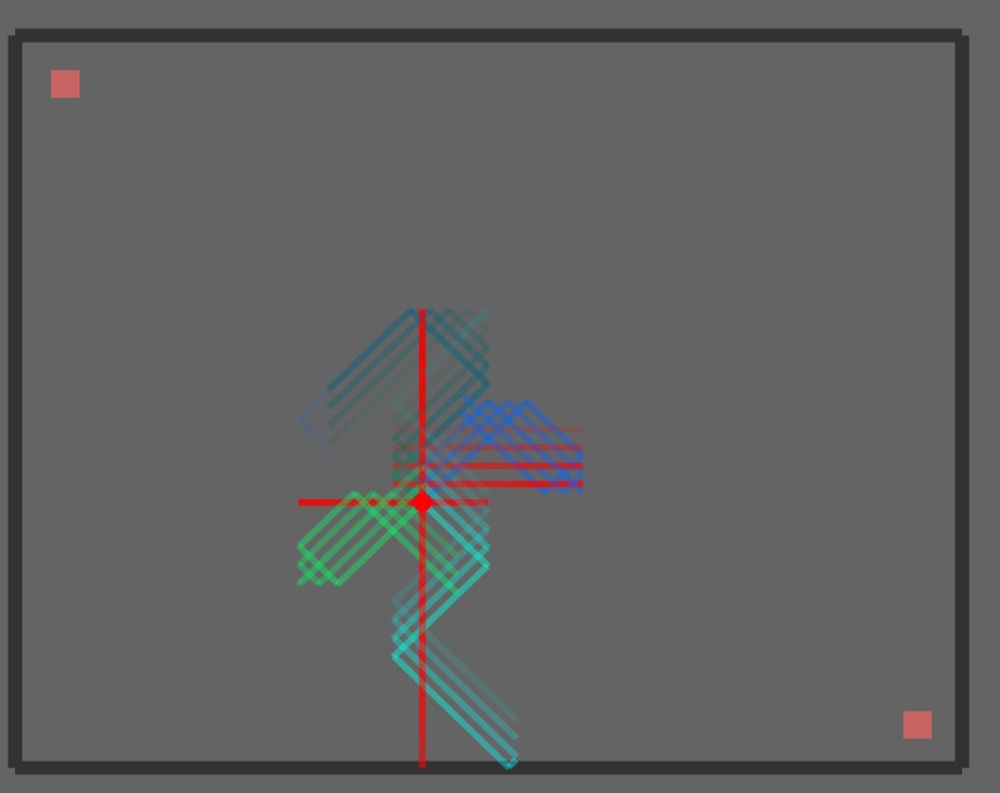

[Readme.txt](https://github.com/user-attachments/files/25607685/Readme.txt)
*프로젝트 "암흑 미로" 기초 설명*
암흑 미로란? 기존 출발지에서 도착지로 도달하면 되는 미로에서 테두리를 제외한 모든 내용들을 어둠 속으로 숨깁니다. 
게임 플레이어가 미로 상의 점을 움직일 때마다 빛이 8방향으로 방출되는데, 플레이어는 이때 방출된 빛이 벽에 맞닿아 반사되는 모양을 토대로 미로의 개형을 유추하고 도착지점에 도달하도록 하면 되는 퍼즐 게임입니다. 

* 조작키 설명*
   "키"    |   "설명"            
↑↓←→ |  플레이어 이동       
     l      |  화면 밝게     
     b     |  화면 어둡게        
     f      |  전체 화면 설정     
   메뉴   |  BFS/DFS 실행 선택 

*실행 방법*

Windows 10/11 x64용 실행 파일과 필요한 DLL, 폰트가 포함되어 있습니다.

1. 프로젝트 최상위 폴더의 `Start.bat`를 실행합니다.
2. 콘솔에 `N M:`이 표시되면 가로(N)와 세로(M) 크기를 입력하고 Enter를 누릅니다. 예를 들어 `10 10`을 입력하면 10 × 10 미로가 생성됩니다.
3. “Maze Example” 창에서 **File → Open**을 선택하고, `comsil_project/bin` 폴더에 생성된 `maze0.maz` 파일을 엽니다.
4. 방향키로 빨간색 점을 움직여 오른쪽 하단의 빨간색 네모(도착지)에 도달하면 “!! CLEAR !!” 문구가 표시됩니다.

실행 파일 옆의 DLL과 `data` 폴더는 이동하거나 삭제하지 말고 함께 유지해 주세요.

*참고하면 좋을 사항*
1. 5 x 5 이상으로 미로 크기를 입력해 주세요.
2. 전체화면으로 실행 시 도착지에 도달 후 "!! clear !!"문구는 보이지 않습니다. 다만 도착지에 도달하면 자동으로 미로의 화면을 다시 밝게 해주니 화면의 밝기가 변한다면 원활하게 도착지에 도착하여 클리어 했음을 인지하면 됩니다.
3. 미로의 가로 세로 높이는 달라도 상관없으나 각각의 크기가 너무 크면 미로생성에는 문제가 없지만 화면이 넘어가지 않아 플레이에 어려움이 있습니다.
